<div align="center">
  
</div>

# Trowser — a browser that lives in your terminal

A keyboard-driven, btop-style TUI web browser. Headless Chrome renders the
page, `blessed` draws the UI, and you drive everything from one fixed-width
screen — omnibox, reader mode, downloads, feeds, games, and an AI sidekick.

**Browsing and YouTube work out of the box with zero configuration and zero
private data.** Email and AI are opt-in extras (see [Configuration](#configuration)).

## Quick start

```bash
npm install
npm start          # or: npm run dev
```

First launch starts at the dashboard; the omnibox is your input buffer. Type
`/help` for the full command list, or `Esc` to back out of anything.

> Headless Chrome launches **lazily** — booting the TUI never opens a browser.

## Features

| Area | What you get |
|---|---|
| **Navigation** | `/open` `/back` `/forward` `/reload` `/home` `/bookmarks` `/history`, search-as-you-type suggestions |
| **Reader mode** | Readability-backed article extraction, in-page `/find`, `/copy` |
| **Search engines** | DuckDuckGo, Bing, Brave — switchable from `/settings` |
| **YouTube & media** | `/yt` fast search, `/videos` `/watch` `/gallery`, `/quality`, `/play` `/queue` `/next` `/stop`, `/download` — hands off to `mpv` so the TUI keeps running |
| **Feeds & git** | `/feeds` RSS reader, `/git` repo cards, `/pdf` page-to-PDF |
| **AI** | `/ai` chat over OpenRouter free-tier models, `/ai-key` to save a key |
| **Accounts** | Local-only `/register` `/login` `/logout` `/profile` — scrypt-hashed vault, no third party |
| **Cookies** | `/cookies` imports a Playwright JSON export from your regular browser |
| **Themes** | 76 built-in themes (dracula, gruvbox, kanagawa, matrix, synthwave84, …) |
| **Extras** | `/pets` companions, `/pong` `/game`, `/bench`, `/settings`, `/shortcuts` |

## Commands

```
Media      /yt /videos /watch /gallery /quality /play /queue /next /stop /download
Navigate   /open /back /forward /reload /home /bookmarks /history /mail
Read+AI    /find /copy /ai /ai-key /pdf /feeds /git
Account    /cookies /profile /pets /login /logout /register /resend
App        /settings /shortcuts /game /pong /bench /help /quit
```

Every command has aliases — `/help` shows them, and `/shortcuts` shows keys.

## Configuration

Everything optional. Set only what you want:

| Variable | Needed for | Notes |
|---|---|---|
| `SMTP_USER` | `/login` `/register` `/resend` OTP emails | Your full Gmail address |
| `SMTP_PASS` | ″ | A [Gmail app password](https://myaccount.google.com/apppasswords) |
| `OPENROUTER_API_KEY` | `/ai` | Free key at <https://openrouter.ai/keys>, or use `/ai-key` to save it to a `0600` file |

```bash
export SMTP_USER='you@gmail.com'
export SMTP_PASS='your-app-password'
export OPENROUTER_API_KEY='sk-or-...'
npm start
```

**Without any of these, browsing, reader mode, YouTube, feeds, games and
everything else still work** — only the OTP email reports
`SMTP not configured` (the on-screen code is still shown), and `/ai` prints
setup instructions instead of a reply.

Optional external tools:

- **`yt-dlp`** — best titles for `/yt` (falls back to Invidious without it)
- **`mpv`** — playback handoff for `/watch` and `/play`

Config lives in `$XDG_CONFIG_HOME/tui-browser/` (default
`~/.config/tui-browser/`): `config.json`, the account vault, and the
`0600` OpenRouter key file. Nothing is written outside it.

## Structure

```
src/
  index.js          boot, blessed wiring, event loop
  ui.js             screens, forms, painting
  navigation.js     URL/history stack
  browser.js        Playwright + headless Chrome (lazy)
  commands.js       command router
  commandSpec.js    command catalog (names, aliases, groups)
  engines.js        search engine registry
  readability.js    reader mode
  yt.js             YouTube search + mpv handoff
  themes.js         76 themes
  accounts.js       local vault (scrypt)
  mail.js           OTP sender (env-configured SMTP)
  openrouter.js     /ai client (env or 0600 key file)
  feeds.js gitcard.js pdf.js pets.js pong.js piano.js …
tests/              24 files, run with `node --test`
scripts/            PTY/key-matrix test drivers, e2e journey
```

## Tests

```bash
npm test          # full suite
npm run keytest   # PTY keypress matrix (python3)
npm run e2e       # end-to-end journey (python3)
```

## License

[MIT](LICENSE) — package.json `author: rv2`.
